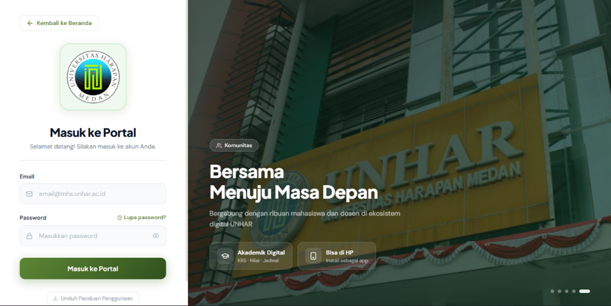
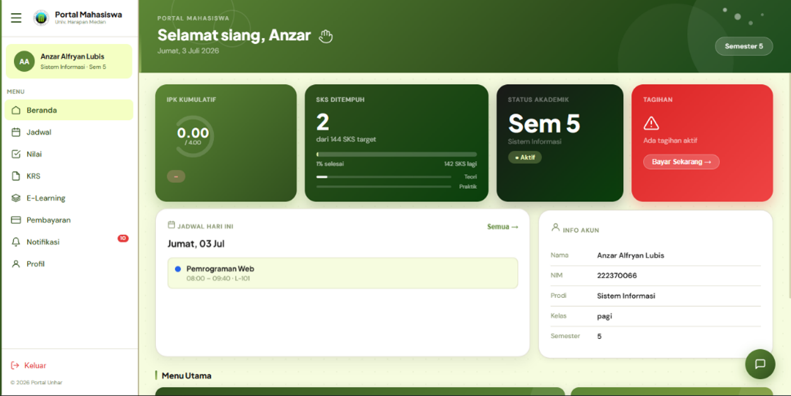
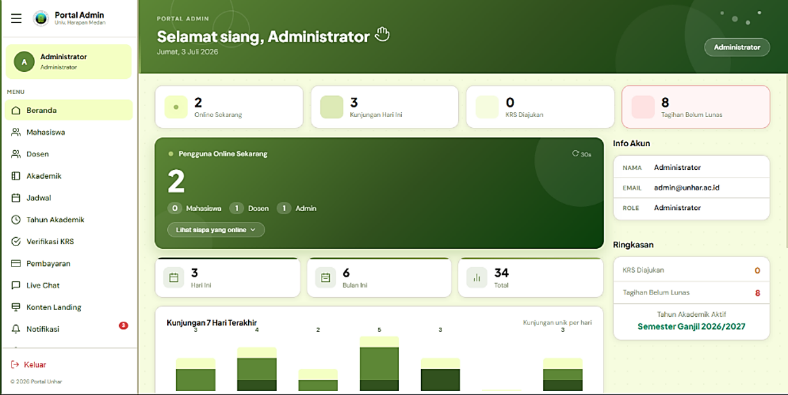
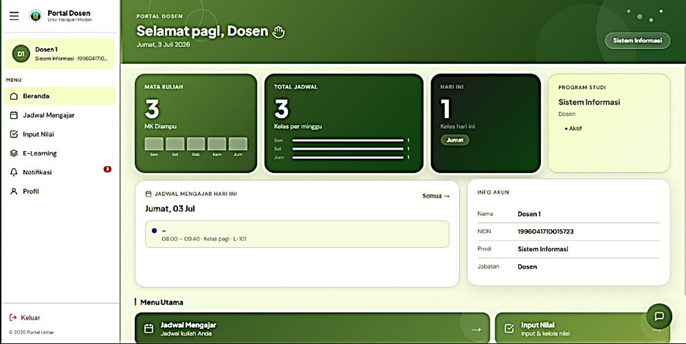
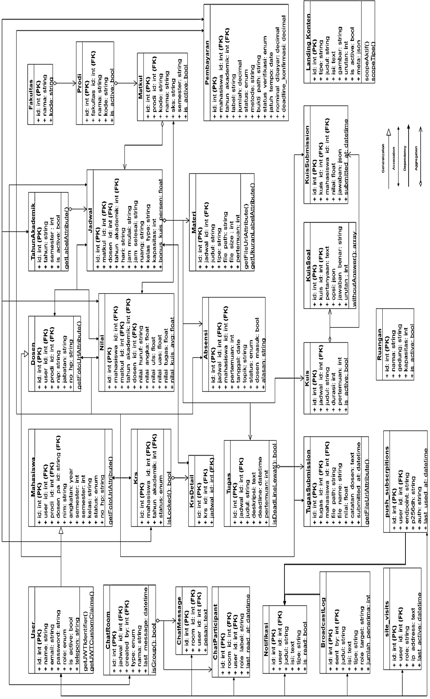

# Portal UNHAR Medan

Portal akademik berbasis **Progressive Web App (PWA)** yang menyatukan SIA dan e-Learning Universitas Harapan Medan dalam satu platform untuk **mahasiswa, dosen, dan admin**.

📄 **Asal proyek:** skripsi *"Pengembangan Sistem Informasi Akademik Universitas Harapan (UnHar) Medan"*, Program Studi Sistem Informasi, Universitas Harapan Medan (2026).

## Latar Belakang

SIA dan e-Learning kampus sebelumnya berjalan terpisah, dengan database dan login yang berbeda, serta tanpa notifikasi atau komunikasi terpadu. Portal ini menyatukan keduanya, bisa dipasang seperti aplikasi di perangkat, dan tetap bisa dibuka saat koneksi internet tidak stabil.

## Fitur

**Mahasiswa**
- Pengisian KRS (validasi maksimal 24 SKS, kunci KRS, ajukan buka kunci)
- Pembayaran UKT dan riwayat transaksi
- Absensi, nilai, dan jadwal kuliah
- e-Learning: materi, tugas, dan kuis
- Live chat dengan dosen dan admin

**Dosen**
- Jadwal mengajar
- Input nilai (UTS, UAS, tugas, kehadiran, bonus kuis)
- Kelola absensi per pertemuan
- Upload materi, buat tugas dan kuis

**Admin**
- Kelola pengguna, data akademik (fakultas, prodi, mata kuliah), dan jadwal
- Verifikasi dan buka kunci KRS
- Kelola tagihan dan pembayaran
- Broadcast notifikasi
- Kelola konten landing page

**Teknis**
- PWA: bisa diinstal, akses offline lewat service worker, dan web push notification (VAPID)
- Strategi caching: NetworkFirst (API), CacheFirst (gambar), StaleWhileRevalidate (font)
- Autentikasi JWT dengan otorisasi berbasis peran (mahasiswa, dosen, admin)
- Idle timeout dan validasi ulang token saat aplikasi dibuka kembali

## Tech Stack

| Bagian | Teknologi |
|---|---|
| Frontend | React, Vite, Service Worker (Workbox) |
| Backend | Laravel 12 (REST API) |
| Database | MySQL |
| Autentikasi | JSON Web Token (JWT) |
| Notifikasi | Web Push (VAPID) |
| Pengujian | Black box testing, Google Lighthouse |

## Struktur Repo

```
portal-unhar/
├── portal-api/        # Backend (Laravel 12)
├── portal-unhar-2/    # Frontend (React + Vite)
└── docs/              # Screenshot dan diagram
```

## Screenshot

| Login | Beranda Mahasiswa | Beranda Admin | Dosen
|---|---|---|
|  |  |  |  |

## Arsitektur dan Database



Arsitektur *decoupled*: frontend React berkomunikasi dengan backend Laravel lewat REST API. Basis data `portal_unhar` terdiri dari sekitar 28 tabel.

## Cara Menjalankan di Lokal

**Prasyarat:** PHP 8.2+, Composer, Node.js, MySQL (bisa memakai Laragon).

### 1. Clone repo

```bash
git clone https://github.com/anzaralfryan/portal-unhar.git
cd portal-unhar
```

### 2. Backend

```bash
cd portal-api
composer install
cp .env.example .env
php artisan key:generate
```

Buat database kosong bernama `portal_unhar` di MySQL, lalu sesuaikan `DB_USERNAME` dan `DB_PASSWORD` di file `.env`.

Isi juga `JWT_SECRET` dan kunci VAPID (lihat bagian **Kunci VAPID** di bawah), lalu:

```bash
php artisan migrate --seed
php artisan serve
```

Backend berjalan di `http://localhost:8000`.

### 3. Frontend

Buka terminal baru:

```bash
cd portal-unhar-2
npm install
npm run dev
```

Frontend berjalan di `http://localhost:5173`.

### Kunci VAPID (untuk web push)

Buat sepasang kunci:

```bash
npx web-push generate-vapid-keys
```

Isi `VAPID_PUBLIC_KEY` dan `VAPID_PRIVATE_KEY` di `.env` backend. Jangan pernah meng-commit file `.env`.

## Akun Demo

| Role | Email | Password |
|---|---|---|
| Mahasiswa | mahasiswa@demo.com | ganti-dengan-password-demo |
| Dosen | dosen@demo.com | ganti-dengan-password-demo |
| Admin | admin@demo.com | ganti-dengan-password-demo |

*Seluruh data pada repo ini adalah data dummy.*

## Hasil Pengujian

**Black box testing:** seluruh fitur utama pada halaman login, mahasiswa, dosen, dan admin berjalan sesuai yang diharapkan.

**Audit Lighthouse** (Chrome DevTools, environment lokal):

| Halaman | Performa | Aksesibilitas | Praktik Terbaik | SEO |
|---|---|---|---|---|
| Landing Page | 69 | 78 | 96 | 92 |
| Login | 99 | 73 | 96 | 92 |
| Beranda Mahasiswa | 97 | 92 | 96 | 92 |
| E-Learning Mahasiswa | 92 | 92 | 96 | 92 |
| Beranda Dosen | 97 | 92 | 96 | 92 |
| Beranda Admin | 97 | 90 | 96 | 92 |

## Batasan dan Rencana Pengembangan

- Belum terintegrasi dengan payment gateway dan Single Sign-On kampus
- Performa landing page (banyak aset visual) dan aksesibilitas halaman login masih bisa ditingkatkan
- Tampilan difokuskan pada desktop, meskipun aspek PWA (manifest dan installability) sudah diterapkan
- Rencana: preferensi notifikasi per pengguna, refresh token yang lebih ketat, dan pencatatan log aktivitas

## Penulis

**Anzar Alfryan Lubis**
GitHub: [@anzaralfryan](https://github.com/anzaralfryan)
